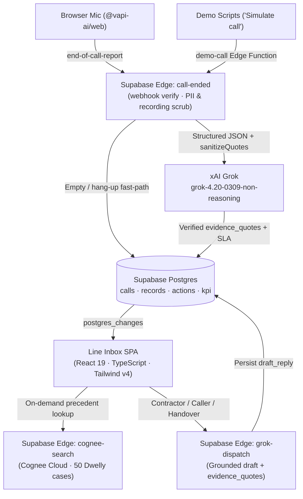

# Line Inbox — Morning Lane

**AI voice front desk & Grok-traceable triage inbox for UK residential property management.**

[](https://grok-realestate-hackathon.vercel.app)
[](./DEMO_GUIDE.md)
[](https://x.ai)
[](https://supabase.com)
[](https://react.dev)

> **Live App:** [https://grok-realestate-hackathon.vercel.app](https://grok-realestate-hackathon.vercel.app) · **Stage Script & Judge Q&A:** [`DEMO_GUIDE.md`](./DEMO_GUIDE.md)

---

## Why Line Inbox?

UK residential lettings and property management teams wake up to fragmented out-of-hours voicemails, incomplete call notes, and urgent tenant enquiries. When a caller reports an active boiler leak, gas smell, lock failure, or rent arrears overnight, slow triage escalates into property damage or compliance risk—and **black-box AI summaries cannot be trusted without proof**.

**Line Inbox — Morning Lane** turns every inbound property call into an auditable operational record:

- **Zero missed emergencies:** 24/7 AI voice front desk captures safety status, property address, spelled surname, and read-back callback digits.
- **Zero hallucinations:** Every Grok field is backed by **word-for-word `evidence_quotes`** verified server-side against the transcript. Click any quote to scroll to and highlight the exact spoken turn.
- **Institutional memory:** Every ticket automatically surfaces **Similar Dwelly Cases** from 50 indexed property-management records via **Cognee Cloud**.
- **Action in one click:** Draft grounded **Contractor Work Orders**, **Caller SMS**, or **Shift Handover** notes directly from the verified transcript.

---

## 4-Step Product Walkthrough

1. **Tenant Calls the AI Line (`Vapi`)**
   Click **Call the line** in the browser (or use **Demo scripts → Simulate call** for mic-free testing). The Morning Lane assistant runs UK safety checks (gas smell, electrics clearance), confirms the property address, spells back surnames, and reads back callback digits with live streaming captions.
2. **Grok Triages & Extracts Verbatim Proof (`xAI Grok`)**
   On call end, the `call-ended` Edge Function verifies the webhook secret, strips caller PII/recording URLs, and sends the transcript to `grok-4.20-0309-non-reasoning`. Grok returns structured priority (`urgent` / `today` / `week` with `Europe/London` working-day SLA), category, safety check, triage rationale, and **word-for-word `evidence_quotes`** checked against the transcript by `sanitizeQuotes`.
3. **Real-Time Workbench Syncs Without Reloads (`Supabase Realtime`)**
   The call, triaged record, and follow-up checklist item are stored in Postgres and pushed over `postgres_changes` directly into the open Inbox and KPI telemetry strip.
4. **Review Precedents & Dispatch in One Click (`Cognee Cloud` + `grok-dispatch`)**
   Managers inspect highlighted **Source Evidence**, review **Similar Dwelly Cases** from the `morning_lane_dwelly` dataset, generate tailored **Contractor / Caller / Handover** drafts via `grok-dispatch`, and click **Mark done** (`d`).

---

## Architecture



---

## Key Engineering Highlights

- **Server-Side Quote Verification (`supabase/functions/call-ended/index.ts`, `grok-dispatch/index.ts`):** `sanitizeQuotes` / `verifyQuotes` normalises whitespace and accepts only exact substrings present in the raw transcript. In `src/components/RecordWorkbench.tsx`, clicking any quote jumps directly to and highlights the spoken line.
- **PII & Payload Hygiene:** `stripSensitive` removes phone numbers, customer objects, and recording URLs before persisting webhook payloads, and stores caller names as initials only (`caller_initials`, e.g., `P. P.`).
- **Clean Hang-Up Fast-Path & Deterministic Fallback:** Calls where the caller disconnects without speaking are logged as `"Hung up at greeting"` (`No action`) without wasting an LLM call. If the LLM is unreachable, `regexFallback` preserves structured UK lettings triage.
- **Vault-Backed Runtime Secrets (`supabase/migrations/0002_line_runtime_secret.sql`):** Edge Functions fetch `XAI_API_KEY`, `VAPI_WEBHOOK_SECRET`, `COGNEE_API_KEY`, and `COGNEE_BASE_URL` via a `service_role`-only `line_runtime_secret` RPC (`SECURITY DEFINER`), with environment variable fallback.
- **Keyboard-First Triage UX (`src/App.tsx`):** Navigate records with `j` / `k`, jump to search with `/`, mark actions done with `d`, mute calls with `m`, and open the shortcut modal with `?`.

---

## Tech Stack

| Layer | Technology | Purpose |
|---|---|---|
| **Frontend** | React 19, TypeScript, Vite 8, Tailwind CSS v4 | Split-pane Inbox, Live Call Dock, Quote-Jump Workbench, Telemetry Strip |
| **Voice AI** | `@vapi-ai/web`, Deepgram `nova-3` (`en-GB`), OpenAI `gpt-4.1`, ElevenLabs | 24/7 UK lettings voice intake, safety screening & live captions |
| **Triage & Drafting** | xAI `grok-4.20-0309-non-reasoning` | Structured JSON extraction, triage rationale, verbatim quotes & 3-mode dispatch |
| **Case Memory** | Cognee Cloud (`morning_lane_dwelly`) | Semantic precedent matching across 50 indexed Dwelly property cases |
| **Backend & Data** | Supabase Postgres, Realtime, Vault & Deno Edge Functions | Persistence, live `postgres_changes` sync, KPI view & serverless orchestration |
| **Hosting & Tooling** | Vercel, `oxlint`, Cursor | Production SPA deployment, linting & end-to-end build workflow |

---

## Quick Start

> **Security note:** Never commit `.env`, `.env.local`, `.cursor/mcp.json`, `data/`, or `backups/`. Always start from `.env.example`.

1. **Copy the environment template:**
   ```bash
   cp .env.example .env
   ```
   Set the frontend variables in `.env`:
   - `VITE_SUPABASE_URL`
   - `VITE_SUPABASE_ANON_KEY`
   - Optional for live browser calls: `VITE_VAPI_PUBLIC_KEY`, `VITE_VAPI_ASSISTANT_ID`

   Configure backend runtime secrets in **Supabase Vault** (consumed by `line_runtime_secret`) or **Supabase Edge Function secrets**:
   - `XAI_API_KEY`
   - `VAPI_WEBHOOK_SECRET`
   - `COGNEE_API_KEY`, `COGNEE_BASE_URL`

2. **Install dependencies and run locally:**
   ```bash
   npm install
   npm run dev
   ```

3. **Type-check, build, and lint:**
   ```bash
   npm run build
   npm run lint
   ```

---

## Repository Map

```text
.
├── DEMO_GUIDE.md                         # 2-minute stage script, demo flow & judge Q&A
├── README.md                             # Project overview, architecture & setup
├── .env.example                          # Safe environment variable template
├── .cursor/mcp.json.example              # MCP server template (Supabase, Parallel, Cognee)
├── src/
│   ├── App.tsx                           # Main Line Inbox layout, keyboard shortcuts & live call state
│   ├── types.ts                          # TypeScript models for calls, records, Grok & Cognee payloads
│   ├── components/
│   │   ├── InboxPane.tsx                 # Searchable, filterable, priority-sortable call & Dwelly queue
│   │   ├── RecordWorkbench.tsx           # Structured record, Source Evidence highlighter, Cognee & Dispatch
│   │   ├── LiveCallDock.tsx              # Active Vapi call controls, audio meters & streaming captions
│   │   ├── DemoPromptsPopover.tsx        # Caller test scripts & one-click "Simulate call" backup
│   │   ├── TelemetryStrip.tsx            # Live KPI strip & Supabase Realtime connection badge
│   │   └── ShortcutsModal.tsx            # Keyboard shortcut reference (?)
│   └── lib/
│       ├── inbox.ts                      # Supabase queries, Realtime subscriptions & optimistic updates
│       ├── lineCall.ts                   # @vapi-ai/web lifecycle, live captions & end-of-call snapshot
│       ├── demoCall.ts                   # Client trigger for simulated & fallback triage calls
│       ├── grok.ts                       # Client helper for grok-dispatch Edge Function
│       ├── cognee.ts                     # Client helper & cache for cognee-search Edge Function
│       ├── format.ts                     # Transcript parser, quote highlighter & UK SLA formatters
│       └── supabase.ts                   # Browser Supabase client
└── supabase/
    ├── config.toml                       # Supabase Edge Function configuration
    ├── migrations/
    │   ├── 0001_init.sql                 # calls, records, actions tables, kpi view & Realtime publication
    │   ├── 0002_line_runtime_secret.sql  # service_role-only Vault secret reader RPC
    │   └── 0003_grok_traceability.sql    # Grok model, latency, reasoning, evidence_quotes & draft_reply
    └── functions/
        ├── call-ended/index.ts           # Vapi webhook -> PII scrub -> Grok triage -> verified quotes
        ├── grok-dispatch/index.ts        # Contractor / Caller / Handover drafting with Grok
        ├── cognee-search/index.ts        # Cognee Cloud search over morning_lane_dwelly (50 cases)
        └── demo-call/index.ts            # Simulated UK lettings call & live fallback triage
```
